# FlowPilot AI

### Multi-Agent Workflow Orchestration & Business Automation Platform

**FlowPilot AI** is a self-hostable, multi-user AI automation platform that transforms natural-language instructions into structured, executable workflows.

Built using LangGraph, FastAPI, Next.js, PostgreSQL, Redis, and Celery, the platform combines multi-agent orchestration, user-configurable LLM providers, external application integrations, human-in-the-loop authorization, reliable background execution, and real-time operational monitoring.

Designed with a production-oriented architecture, FlowPilot AI enables users to create, schedule, approve, execute, and monitor business automations from a unified enterprise workspace.

**Project status:** Ready with documented limitations, based on the latest engineering audit.

---

## Overview

FlowPilot AI coordinates specialized AI agents to interpret user objectives, construct execution plans, invoke supported tools, and verify execution outcomes.

Unlike a basic AI chatbot, FlowPilot AI maintains persistent execution state and supports asynchronous processing, scheduled automation, secure external integrations, and explicit human authorization before sensitive actions.

The platform is designed around three principles:

- **User control:** Users manage their own AI providers and external application connections.
- **Reliable execution:** Background processing, durable checkpoints, transactional outbox handling, and recovery mechanisms support long-running workflows.
- **Security and accountability:** User isolation, encrypted credentials, approval gates, and external-action audit records protect sensitive operations.

---

## Key Features

### 1. Multi-Agent Workflow Orchestration

LangGraph coordinates specialized agents throughout the execution lifecycle:

- Intent analysis.
- Workflow planning.
- Capability and tool selection.
- Human approval when required.
- External action execution.
- Result verification.
- Completion and failure reporting.

Persistent PostgreSQL checkpoints support interruption and execution resumption.

### 2. Multi-LLM — Bring Your Own Key (BYOK)

Connect your preferred AI provider directly through the frontend.

Supported providers:

- Google Gemini.
- OpenAI.
- Groq.

Capabilities include:

- Secure API-key configuration.
- Dynamic model discovery.
- Provider and model selection.
- Default-model preferences.
- Connection testing.
- Token consumption monitoring.
- Estimated inference costs.
- LLM generation audit history.

Sensitive provider credentials are encrypted at rest.

### 3. App Connections

Configure external business applications directly within FlowPilot AI without accessing server environment files.

Supported integrations:

| Application | Capabilities |
|---|---|
| Gmail | Authenticated email automation |
| Google Sheets | Spreadsheet operations |
| Slack | Workspace communication |
| WhatsApp Business | Template messaging and delivery-status tracking |

App Connections provides:

- Guided provider setup.
- Built-in credential acquisition instructions.
- User-managed application credentials.
- OAuth authorization where supported.
- Encrypted credential storage.
- Secure credential replacement.
- Connection testing.
- Saved configuration indicators.
- Per-user connection isolation.

Stored secrets are never returned through normal API responses in plaintext.

### 4. Human-in-the-Loop Approval

Sensitive external actions require explicit user authorization.

Before executing an applicable operation, FlowPilot pauses and presents its parameters for review.

Users can inspect the intended action and approve or reject it.

The system maintains approval records and parameter-integrity information to support traceability and prevent unauthorized execution.

### 5. Smart Scheduling

Create one-time and recurring automations with timezone-aware execution.

Features include:

- Scheduled workflow creation.
- Recurring execution.
- Pause and resume controls.
- Active Schedules and Schedule History.
- Automatic execution creation.
- Upcoming workflow reminders.
- Live 15-second countdown.
- Human approval notifications.
- Direct navigation to related executions.

Completed one-time schedules move into Schedule History without removing their associated execution records.

### 6. Persistent Notification Center

A centralized notification system keeps users informed about:

- Upcoming scheduled workflows.
- Workflow execution starts.
- Pending human approvals.
- Relevant system events.

Notifications are persisted in PostgreSQL and remain available across navigation and browser refreshes.

Optional browser notifications are supported when permission is granted and browser conditions allow them.

### 7. Asynchronous Execution and Recovery

FlowPilot uses Celery and Redis to separate workflow execution from HTTP request handling.

Reliability features include:

- Asynchronous execution.
- Transactional outbox processing.
- Persistent execution records.
- Worker heartbeat monitoring.
- Abandoned-run recovery.
- Scheduled-run recovery.
- Duplicate-dispatch safeguards.
- Persistent LangGraph checkpoints.

### 8. Real-Time Monitoring and Auditing

The application provides visibility into:

- Workflow status.
- Agent-generated execution plans.
- Current execution steps.
- Live audit telemetry.
- Approval decisions.
- External-action results.
- Provider-specific delivery states.
- Final verification output.

External API acceptance and confirmed recipient delivery are treated as distinct outcomes.

---

## Application Interface

FlowPilot AI uses the **Modern Enterprise** design system, featuring a charcoal navigation sidebar, deep teal-slate application header, and responsive operational workspace.

The frontend includes:

| Module | Purpose |
|---|---|
| Overview | Operational dashboard and system metrics |
| New Workflow | Create and execute AI-powered workflows |
| Executions | Monitor current and historical runs |
| Approvals | Review and authorize sensitive actions |
| Schedules | Configure scheduled automations |
| Integrations | Monitor external integration health |
| Multi-LLM (BYOK) | Configure AI providers and models |
| App Connections | Configure external business applications |
| Account Profile | Manage account information |

### Application Screenshots

#### Operations Dashboard

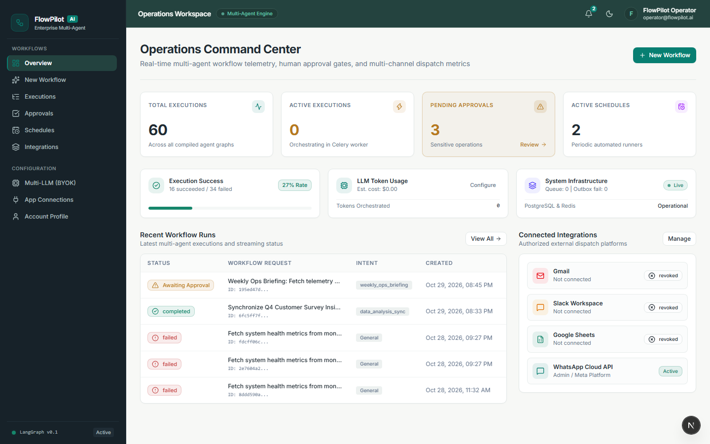

#### AI Workflow Creation

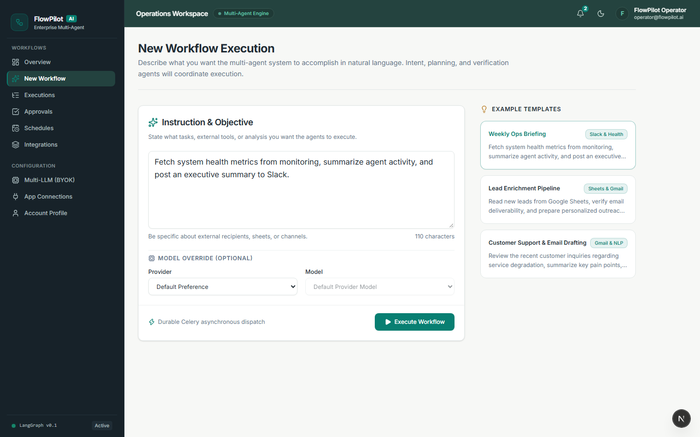

#### Multi-Agent Execution Monitoring

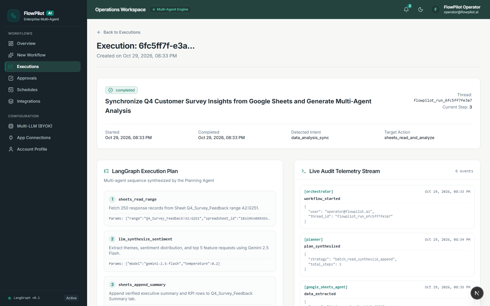

#### Human-in-the-Loop Approvals

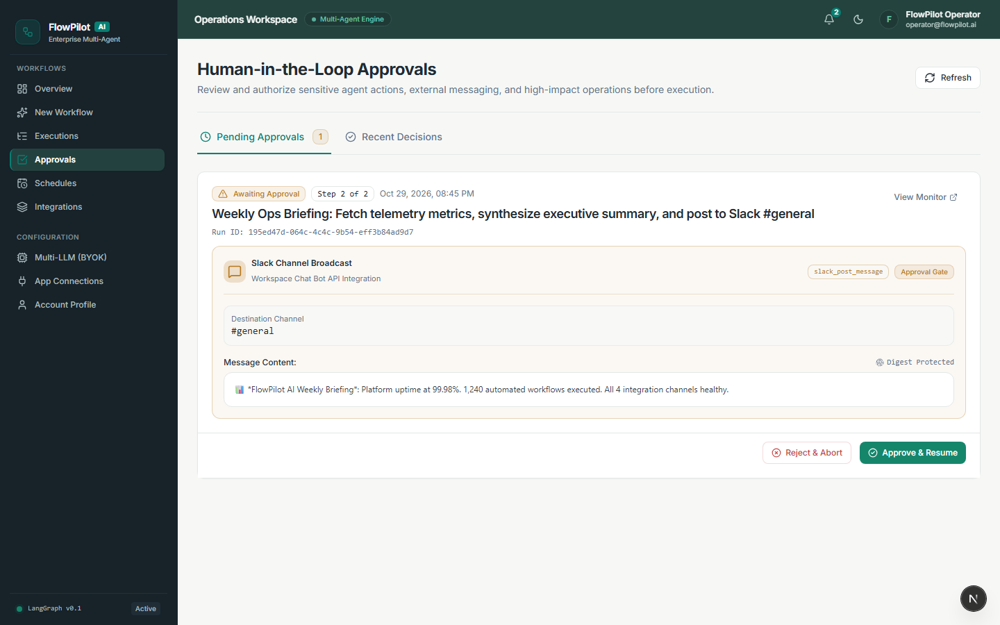

#### Smart Scheduling

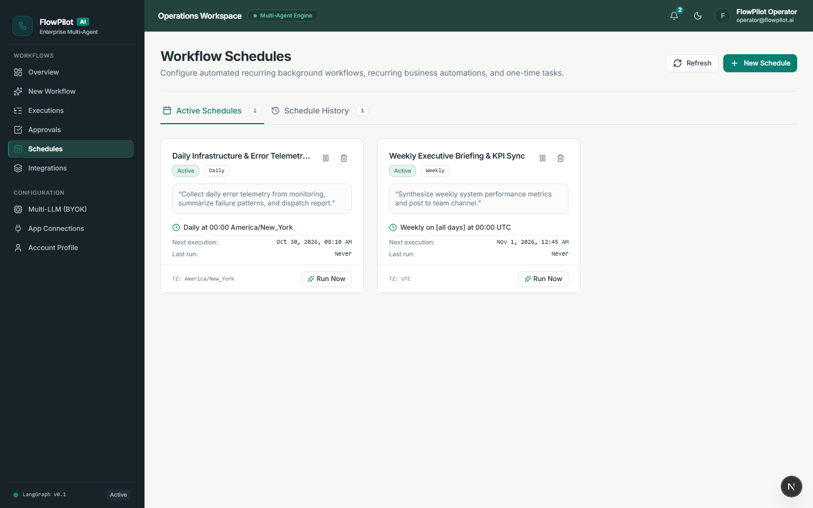

#### Multi-LLM Configuration

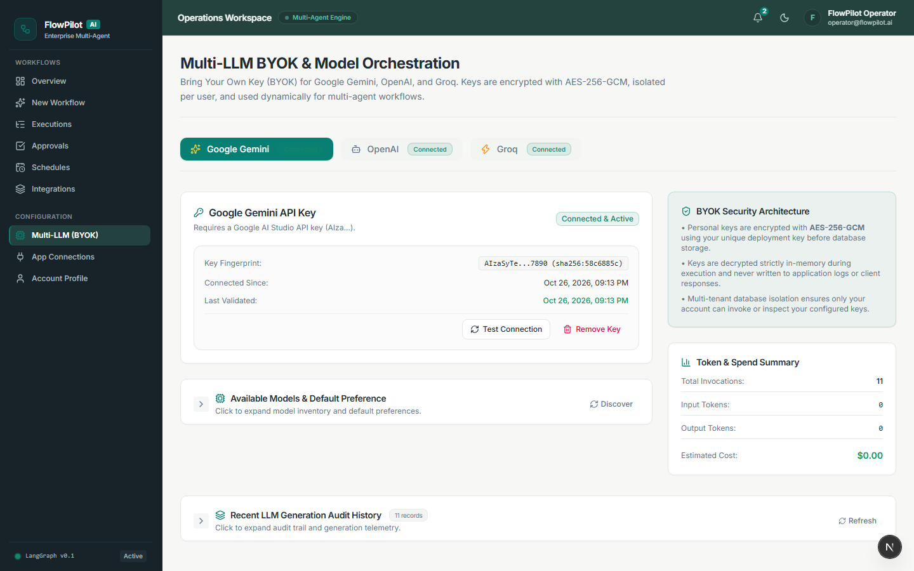

#### App Connections

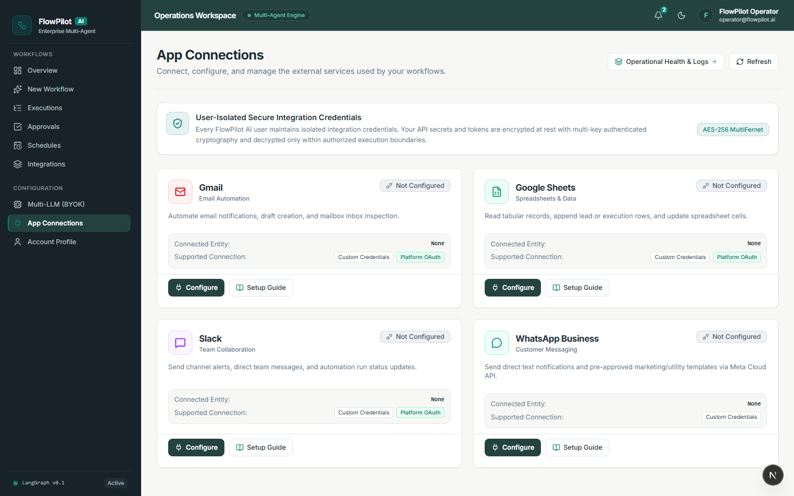

#### Notification Center

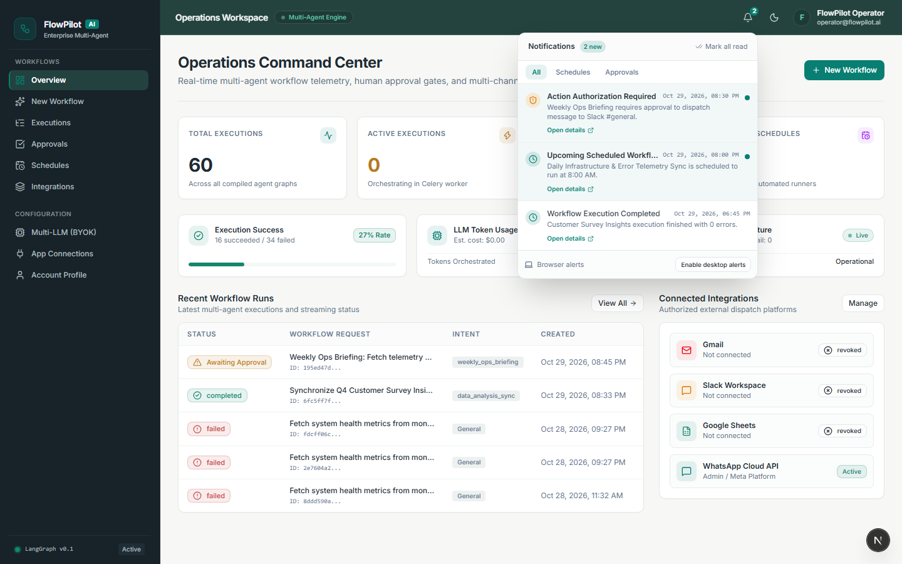

#### Integrations Monitoring

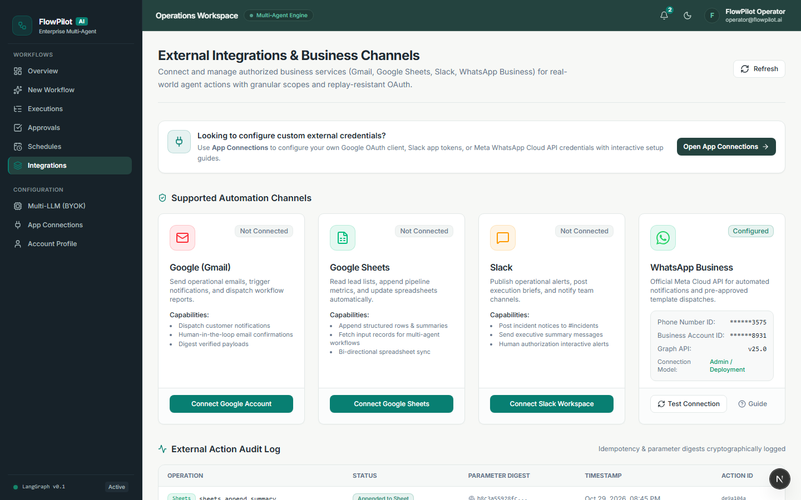

#### Account Profile

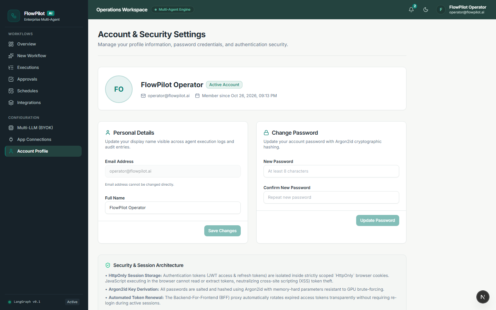

#### Responsive Operations Dashboard

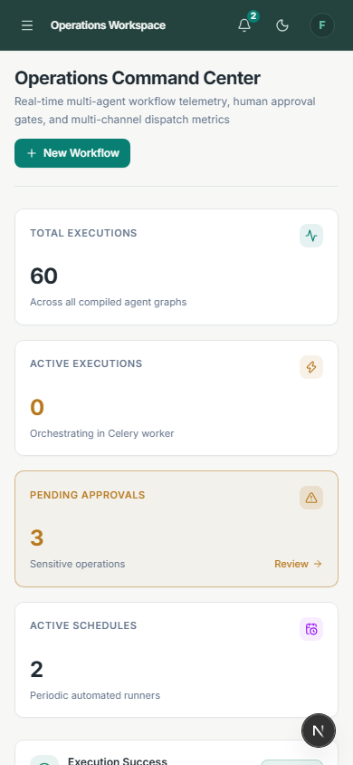

---

## System Architecture

FlowPilot AI separates the frontend, API, background execution, persistence, and external provider layers.

```text
                         USER / BROWSER
                               |
                               v
                    Next.js Frontend (BFF)
                               |
                               v
                         FastAPI Backend
                               |
              +----------------+----------------+
              |                |                |
              v                v                v
         Authentication    LLM Gateway    App Connections
              |                |                |
              |          Gemini/OpenAI/Groq     |
              |                                 |
              +----------------+----------------+
                               |
                               v
                       Workflow Services
                               |
                               v
                     LangGraph Agent Engine
                               |
                +--------------+--------------+
                |              |              |
                v              v              v
          Intent/Planning   Approval Gate   Verification
                |              |              |
                +--------------+--------------+
                               |
                               v
                      External Execution
                               |
                  +------------+------------+
                  |            |            |
                  v            v            v
                Gmail      Slack/Sheets   WhatsApp
                               |
                               v
                       External Audit Trail


                     BACKGROUND SERVICES

          PostgreSQL <----> FastAPI / LangGraph
              |
              +-- Application Records
              +-- Encrypted Credentials
              +-- Workflow Checkpoints
              +-- Execution History
              +-- Approvals & Notifications

          Redis <----------> Celery Worker
                                  ^
                                  |
                              Celery Beat
                                  |
                                  v
                         Scheduled Workflows
```

### Execution Lifecycle

A typical workflow progresses through:

```text
User Instruction
      |
      v
Workflow Submission
      |
      v
Intent Analysis
      |
      v
Planning Agent
      |
      v
Human Approval (if required)
      |
      v
Execution Agent
      |
      v
Verification Agent
      |
      v
Completed / Failed
```

Workflow submissions are processed asynchronously.

Sensitive external operations must pass their required authorization gates before dispatch.

---

## Technology Stack

| Layer | Technologies |
|---|---|
| Frontend | Next.js 16, React 19, TypeScript |
| Styling | Tailwind CSS, centralized design tokens |
| Frontend State | TanStack Query |
| Backend | Python 3.12, FastAPI, Pydantic |
| Agent Framework | LangGraph, LangChain Core |
| LLM Providers | Google Gemini, OpenAI, Groq |
| Database | PostgreSQL 16 |
| ORM | SQLAlchemy Async |
| Migrations | Alembic |
| Message Broker | Redis 7 |
| Background Processing | Celery and Celery Beat |
| Credential Encryption | MultiFernet |
| Real-Time Monitoring | Server-Sent Events |
| Backend Testing | Pytest |
| Frontend Testing | Vitest, React Testing Library |
| Browser Testing | Playwright |
| Code Quality | Ruff, ESLint, TypeScript |
| Dependency Management | uv, npm |
| Containerization | Docker and Docker Compose |

---

## Getting Started

### Prerequisites

Install the following:

- Python 3.12.
- [uv](https://docs.astral.sh/uv/).
- Node.js and npm compatible with the frontend's package requirements.
- Docker Desktop.
- Docker Compose.
- Git.

The following instructions use Windows Command Prompt.

### Running FlowPilot AI Locally (Windows)

FlowPilot AI provides a streamlined, one-command development workflow for Windows.

#### Step 1 — Start FlowPilot AI

1. Ensure **Docker Desktop** is running.
2. Open Command Prompt (CMD) in the project root (`D:\PROJECTS\FLOWPILOT-AI`) and execute:

```cmd
start-dev.cmd
```

This automated script performs readiness checks and automatically starts:
- **PostgreSQL** (port `5433` via `infrastructure\compose.yaml`)
- **Redis** (port `6379` via `infrastructure\compose.yaml`)
- **FastAPI** backend server (`http://127.0.0.1:8000`)
- **Celery Worker** (using the Windows-compatible `-P solo` pool)
- **Celery Beat** task scheduler
- **Next.js frontend** (`http://localhost:3000`)

The script also verifies service readiness across all components and automatically opens:
[http://localhost:3000](http://localhost:3000/)

By default, processes run silently in the background without opening multiple external CMD windows. Individual service logs are stored inside:
```text
.run/logs/
```
- **FastAPI Backend:** `.run/logs/fastapi.log` (errors: `.run/logs/fastapi.err.log`)
- **Celery Worker:** `.run/logs/celery_worker.log` (errors: `.run/logs/celery_worker.err.log`)
- **Celery Beat:** `.run/logs/celery_beat.log` (errors: `.run/logs/celery_beat.err.log`)
- **Next.js Frontend:** `.run/logs/frontend.log` (errors: `.run/logs/frontend.err.log`)

**For debugging with visible service terminals:**

If you prefer visible terminal windows for each service during debugging, run:

```cmd
start-dev.cmd --show-windows
```
*(Alternative alias flags: `/w` or `-w`)*

#### Step 2 — Optional ngrok (WhatsApp Webhooks Only)

> [!NOTE]
> **ngrok is NOT required for ordinary application usage.**
> You do not need ngrok to use the UI, configure LLM providers (Gemini, OpenAI, Groq), orchestrate multi-agent workflows, connect Gmail, Google Sheets, or Slack, or send outbound WhatsApp messages and templates via the Meta Cloud API.

ngrok is **only needed** when testing incoming external webhooks (such as real-time WhatsApp delivery status updates `sent`, `delivered`, `read` or incoming customer replies) against your local backend, unless another publicly reachable HTTPS endpoint is available.

If you are testing incoming WhatsApp webhooks locally:

1. Open a separate terminal and execute:
   ```cmd
   ngrok http 8000
   ```

2. The canonical WhatsApp callback URL format is:
   ```text
   https://YOUR-NGROK-DOMAIN/api/v1/webhooks/whatsapp
   ```
   *(For example: `https://your-tunnel-id.ngrok-free.app/api/v1/webhooks/whatsapp`)*

3. Register and configure the callback in Meta:
   - In the Meta App Dashboard under WhatsApp Webhook settings, register the actual callback URL using your active HTTPS tunnel domain and the `/api/v1/webhooks/whatsapp` endpoint.
   - Configure the matching webhook verify token (must match `WHATSAPP_WEBHOOK_VERIFY_TOKEN` configured in your backend environment).
   - Subscribe to the `messages` webhook field.
   - Ensure the application is subscribed to the correct WhatsApp Business Account (WABA). See the [WhatsApp Setup Guide](docs/whatsapp-setup.md) for complete instructions.

> [!IMPORTANT]
> Never include an actual ngrok authentication token, Meta access token, or private webhook secret in documentation or version control.

#### Stopping FlowPilot AI

From the project root Command Prompt, execute:

```cmd
stop-dev.cmd
```

This automated script:
- Stops all tracked FlowPilot development processes (FastAPI, Celery Worker, Celery Beat, Next.js frontend) using their recorded process IDs and window title signatures.
- Halts the relevant Docker containers (`docker compose stop`) without deleting persistent database volumes, cached credentials, or encryption keys (it never executes `docker compose down -v`).
- Preserves individual service logs in `.run/logs/` for post-session inspection and troubleshooting.

> [!NOTE]
> If you independently started an optional ngrok process in a separate terminal, stop it separately using `Ctrl+C` in that terminal.

---

### Manual Step-by-Step Setup (Troubleshooting & Development Reference)

The one-command workflow (`start-dev.cmd`) above is the recommended method for everyday local development. The manual steps below are preserved as an optional troubleshooting and development reference for developers who need to isolate, test, or run individual services independently.

#### 1. Navigate to the Project Root

```cmd
cd /d D:\PROJECTS\FLOWPILOT-AI
```

#### 2. Start Infrastructure Containers

Start PostgreSQL and Redis:

```cmd
docker compose -f infrastructure\compose.yaml up -d
```

Verify container status:

```cmd
docker compose -f infrastructure\compose.yaml ps
```

Do not use `docker compose down -v` on an environment containing data you want to preserve.

#### 3. Configure and Start the Backend

Open the backend directory:

```cmd
cd backend
```

Create the local `.env` using the repository's environment template and configure the required infrastructure and security settings.

Install dependencies:

```cmd
uv sync --python 3.12
```

Apply database migrations:

```cmd
uv run alembic upgrade head
```

Start FastAPI:

```cmd
uv run uvicorn flowpilot.main:app --host 127.0.0.1 --port 8000 --reload
```

Backend health endpoint:

http://127.0.0.1:8000/api/v1/health

#### 4. Start Celery Worker (Manual Reference)

If running the worker in an isolated terminal for debugging:

```cmd
cd /d D:\PROJECTS\FLOWPILOT-AI\backend

uv run celery -A flowpilot.workers.celery_app worker --loglevel=info -P solo
```

The `solo` execution pool is used for local Windows development.

#### 5. Start Celery Beat (Manual Reference)

If running the scheduler in an isolated terminal for debugging:

```cmd
cd /d D:\PROJECTS\FLOWPILOT-AI\backend

uv run celery -A flowpilot.workers.celery_app beat --loglevel=info
```

Celery Worker and Celery Beat must remain running for complete asynchronous workflow and scheduling functionality.

#### 6. Start the Frontend (Manual Reference)

If running the frontend independently:

```cmd
cd /d D:\PROJECTS\FLOWPILOT-AI\frontend

npm ci

npm run dev
```

Open the application:

http://localhost:3000

Register or sign in using the existing authentication interface.

For component-specific instructions, refer to:

- [Backend README](backend/README.md)
- [Frontend README](frontend/README.md)

---

## Initial Application Configuration

Once the application is running, complete the following setup.

### Configure an LLM Provider

Navigate to **Multi-LLM (BYOK)**.

Select Gemini, OpenAI, or Groq, enter your own API key, test the connection, and configure your preferred default model.

Official provider portals:

- [Google AI Studio](https://aistudio.google.com/)
- [OpenAI Platform](https://platform.openai.com/)
- [Groq Console](https://console.groq.com/)

Model availability, quotas, and pricing depend on the provider and the user's account.

FlowPilot does not include bundled model inference credits.

### Configure External Applications

Navigate to **App Connections**.

Choose Gmail, Google Sheets, Slack, or WhatsApp Business.

Follow the built-in setup guide to obtain the required credentials and complete authorization.

App Connections supports user-managed credential configuration without requiring ordinary users to edit the backend environment.

The platform retains separate deployment-level settings for infrastructure, encryption, trusted origins, and any platform-managed OAuth applications.

Saving credentials does not automatically mean that OAuth authorization or provider verification is complete.

### Test an Integration

After establishing a connection:

1. Verify its displayed connection status.
2. Use the available Test Connection action.
3. Create a supported workflow.
4. Review the execution plan.
5. Authorize sensitive actions when prompted.
6. Inspect the resulting execution and external-action audit record.

External sends should always use an intended, authorized test recipient during manual testing.

---

## Supported Integrations

### Gmail

Supports authenticated email automation with explicit approval before sensitive dispatch.

A successful Gmail API response confirms that Gmail accepted the send operation. Inbox placement remains subject to recipient-side filtering.

### Google Sheets

Supports spreadsheet automation through authorized Google accounts and appropriate API scopes.

### Slack

Supports authorized workspace communication through a connected Slack application.

### WhatsApp Business

Supports Meta WhatsApp Cloud API template messaging and webhook-based delivery tracking.

Reported delivery states can include:

- Accepted.
- Sent.
- Delivered.
- Read.
- Failed.

A message accepted by Meta is not necessarily delivered to the recipient.

Production use may require additional Meta application permissions, account configuration, and business verification.

---

## Security Architecture

FlowPilot AI incorporates security controls across authentication, authorization, credentials, and workflow execution.

### Authentication

- Secure password hashing.
- JWT-based authentication.
- Refresh-token rotation.
- Session lifecycle management.
- Password recovery.
- Production-aware cookie and origin configuration.

### Credential Protection

- MultiFernet encryption at rest.
- Server-managed encryption keys.
- Masked stored-secret indicators.
- Secure credential replacement.
- User-scoped integration records.
- No plaintext secrets in normal configuration responses.

### Multi-User Isolation

Authenticated users are restricted to their own:

- Workflows.
- Executions.
- Schedules.
- Notifications.
- Approvals.
- BYOK credentials.
- App Connections.
- Integration audit records.

Background workers must resolve the correct user's credentials before executing provider operations.

### Human Authorization

Sensitive actions pause at the approval gate.

Approval details and action parameters are presented for review before execution continues.

### Auditability

The application maintains execution telemetry, approval activity, external-action outcomes, and related persistent records.

The latest production-readiness audit also reported corrections to production credential fallback handling and WhatsApp webhook callback consistency.

---

## Testing and Quality Assurance

FlowPilot AI includes backend, frontend, integration, and browser-level automated tests.

### Backend Validation

From the `backend` directory:

```cmd
uv run ruff check .

uv run ruff format --check .

uv run alembic check

uv run pytest -q
```

### Frontend Validation

From the `frontend` directory:

```cmd
npx tsc --noEmit

npm run lint

npm run test

npm run build
```

Run Playwright through the E2E command configured in the frontend's `package.json`.

### Latest Reported Engineering Audit

The October 28, 2026 production-readiness audit reported:

| Validation | Result |
|---|---|
| Backend tests | 260 passed, 1 skipped |
| Backend lint and formatting | Passed |
| Alembic migration consistency | Passed |
| Frontend component/unit tests | 59 passed |
| TypeScript | Passed |
| ESLint | Passed |
| Next.js production build | 28 routes compiled |
| Playwright browser E2E | 3 passed |
| Multi-user isolation scenarios | 8 passed |

These figures describe the recorded audit and should be updated whenever a newer verified test run is completed.

Automated testing uses mocked provider operations where appropriate. Real external-provider availability must be verified separately.

---

## Deployment

FlowPilot AI is designed for self-hosted deployment using separate frontend, backend, worker, scheduler, PostgreSQL, and Redis services.

Production preparation includes:

1. Configuring deployment-level environment variables.
2. Supplying secure authentication and encryption keys.
3. Configuring persistent database storage.
4. Applying database migrations.
5. Configuring trusted frontend/backend origins.
6. Enabling HTTPS.
7. Starting backend and background services.
8. Registering the correct OAuth callback URLs.
9. Configuring provider webhooks where required.
10. Verifying multi-user isolation and provider connectivity.
11. Configuring monitoring, backups, and recovery procedures.

Provider-owned credentials are configured through App Connections where supported.

Do not expose server encryption keys or authentication secrets through browser-accessible environment variables.

Refer to the deployment documentation and verify the actual production Compose configuration before launching a public instance.

---

## Known Limitations

The latest engineering audit classified FlowPilot AI as **Ready with Documented Limitations**.

Current operating considerations include:

- Users must provide their own supported LLM API keys.
- External application availability depends on provider credentials, permissions, quotas, and account restrictions.
- Public OAuth integrations may require provider verification and correctly registered callback URLs.
- WhatsApp production messaging depends on Meta account eligibility and provider requirements.
- Browser notifications are not guaranteed when the application is completely closed.
- The default self-hosted architecture should be evaluated separately before attempting distributed, multi-node deployment.
- API dispatch success does not always establish downstream message delivery.
- Live external-provider testing requires valid credentials and explicit authorization.

The release status should not be interpreted as certification, a security guarantee, or proof of unrestricted operation with every external provider.

---

## Documentation

Additional technical documentation is organized within the repository.

| Resource | Description |
|---|---|
| [Backend README](backend/README.md) | Backend setup, execution architecture, API overview, and security |
| [Frontend README](frontend/README.md) | Frontend architecture, development, features, and testing |
| [Documentation](docs/) | Detailed technical and operational documentation |

Where present, supplementary guides cover:

- Application architecture.
- External integration setup.
- WhatsApp configuration.
- Deployment.
- Operations and recovery.
- Security.
- Production-readiness assessment.

Keep the documentation aligned with the actual repository and running application.

---

## Project Status

**Release assessment:** Ready with documented limitations.

FlowPilot AI has completed its latest reported engineering audit and is undergoing final documentation and deployment preparation.

A public deployment and final GitHub release should follow environment-specific configuration, deployment smoke testing, and review of any outstanding provider-level limitations.

---

## License

FlowPilot AI is open-source software licensed under the [MIT License](LICENSE). See the [LICENSE](LICENSE) file for complete terms and copyright details.