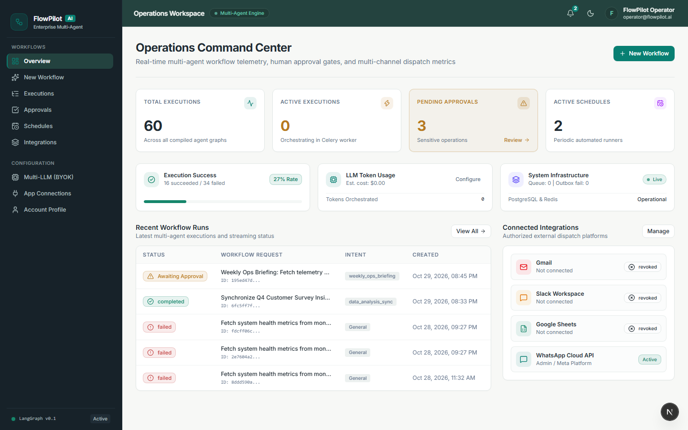
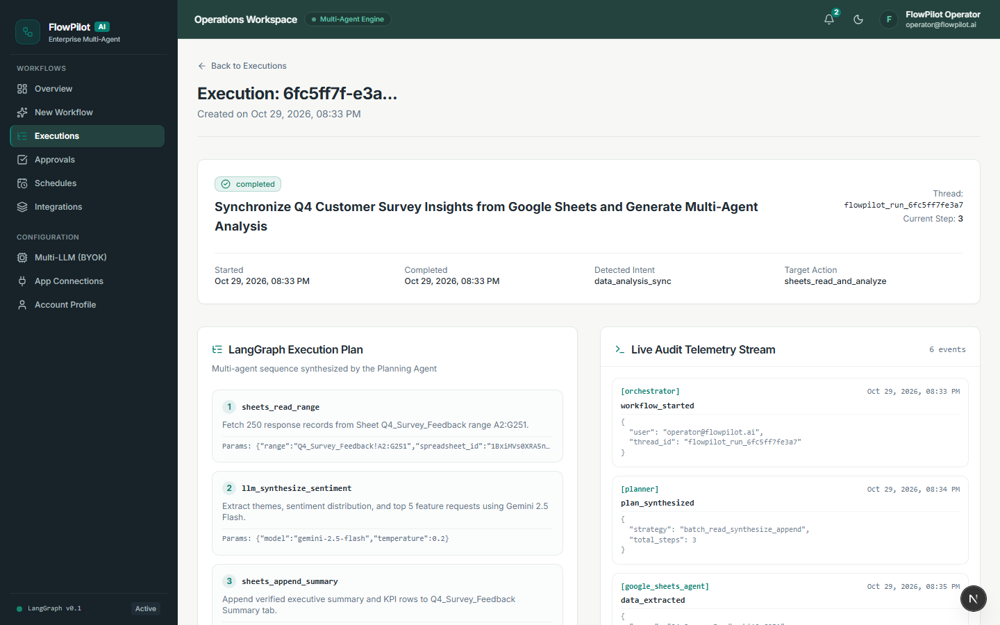
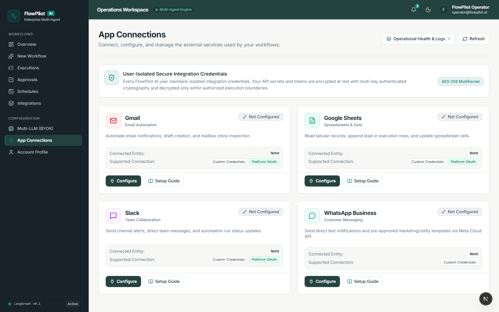
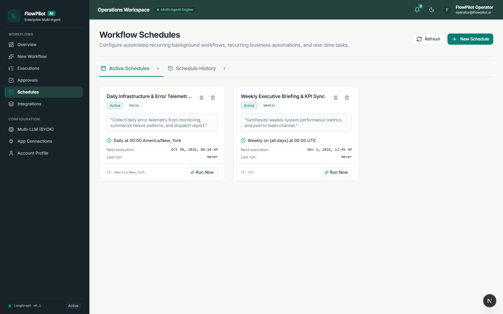

# FlowPilot AI — Frontend

The frontend application for **FlowPilot AI**, a multi-agent workflow orchestration and business automation platform.

Built with **Next.js 16, React 19, TypeScript, and Tailwind CSS**, the application provides a professional interface for configuring AI models, connecting external services, executing workflows, managing human approvals, scheduling automations, and monitoring execution results.

The frontend follows the **Modern Enterprise** design system, featuring a charcoal navigation sidebar, deep teal-slate application header, and responsive workspace.

---

## Features

### Operations Dashboard

A centralized operational workspace displaying:

- Workflow execution statistics.
- Active and completed executions.
- Pending human approvals.
- Active schedules.
- LLM usage and estimated costs.
- Infrastructure health.
- Recent workflow activity.

### Multi-Agent Workflow Execution

- Natural-language workflow creation.
- Configurable LLM provider and model selection.
- Asynchronous workflow submission.
- Execution progress monitoring.
- LangGraph execution-plan visualization.
- Live audit telemetry.
- Agent-generated verification results.
- External-action delivery tracking.

### Multi-LLM (BYOK)

Users can securely configure their own API keys for:

- Google Gemini.
- OpenAI.
- Groq.

Additional capabilities include dynamic model discovery, default-model preferences, connection testing, and LLM generation audit history.

The Available Models and Recent LLM Generation Audit History sections are independently collapsible and start collapsed by default.

### App Connections

Users can configure and manage supported external applications directly through the frontend:

- Gmail.
- Google Sheets.
- Slack.
- WhatsApp Business.

The module provides:

- Interactive provider setup guides.
- Custom application credential configuration.
- OAuth authorization where supported.
- Masked credential indicators.
- Secure credential replacement.
- Connection testing.
- Saved/unsaved configuration indicators.
- Provider-specific connection statuses.

Previously stored secrets are never returned to the frontend in plaintext.

### Human-in-the-Loop Approvals

Sensitive external actions require explicit user authorization.

The interface provides:

- Pending approval management.
- Operation and parameter previews.
- Approval and rejection controls.
- Direct navigation from approval notifications.
- Authorization and execution-status visibility.

Opening an approval notification never automatically authorizes its associated action.

### Smart Scheduling

- One-time and recurring workflow schedules.
- Timezone-aware scheduling.
- Schedule pause/resume.
- Active Schedules and Schedule History.
- Upcoming execution notifications.
- Live 15-second pre-execution countdown.
- Direct links to scheduled execution records.

Completed one-time schedules move into Schedule History without deleting their associated execution records.

### Notification Center

The application header includes a persistent notification center supporting:

- Upcoming workflow reminders.
- Workflow-start notifications.
- Human approval alerts.
- Notification read/dismiss states.
- Direct navigation to related resources.
- Optional browser notifications.

Browser notifications require user permission and are subject to browser availability.

---

## Interface Preview

### Dashboard



### Workflow Execution



### App Connections



### Smart Scheduling



---

## Technology Stack

| Technology | Purpose |
|---|---|
| Next.js 16 | Application framework and routing |
| React 19 | Component architecture |
| TypeScript | Static type checking |
| Tailwind CSS | Styling and responsive layouts |
| TanStack Query | Server-state management |
| Server-Sent Events | Execution telemetry |
| Vitest | Unit and component testing |
| React Testing Library | Component interaction testing |
| Playwright | End-to-end browser testing |
| ESLint | Code quality |

The frontend communicates with FlowPilot's FastAPI backend through its existing authenticated Backend-for-Frontend (BFF) architecture.

---

## Getting Started

> [!TIP]
> **Recommended Application Startup:**
> The recommended way to launch the complete application (Next.js frontend, FastAPI backend, PostgreSQL, Redis, Celery Worker, and Celery Beat) is through `start-dev.cmd` from the project root:
> ```cmd
> cd /d D:\PROJECTS\FLOWPILOT-AI
> start-dev.cmd
> ```
> See the [Root README](../README.md#running-flowpilot-ai-locally-windows) for complete startup options, background logging, optional ngrok configuration, and shutdown instructions.
>
> The steps below are retained for standalone frontend development when backend services are already running or when developing frontend UI components independently.

### Prerequisites

Install:

- Node.js and npm compatible with the project's `package.json` engine requirements.
- Docker Desktop, PostgreSQL, and Redis for the complete local application.
- Python 3.12 and `uv` for the backend.

Follow the [Backend README](../backend/README.md) to start the API and background services.

### 1. Open the Frontend Directory

From Windows Command Prompt:

```cmd
cd /d D:\PROJECTS\FLOWPILOT-AI\frontend
```

### 2. Install Dependencies

```cmd
npm ci
```

This installs dependencies using the existing lockfile.

### 3. Configure Environment Variables

If a frontend environment template is provided, copy it to `.env.local` and configure the required values.

For example, from Windows CMD:

```cmd
copy .env.example .env.local
```

Use the actual environment-variable names defined by the project's existing configuration.

Environment settings must point the frontend/BFF to the appropriate backend service.

Never place JWT signing secrets, encryption master keys, OAuth Client Secrets, or private provider tokens in `NEXT_PUBLIC_*` variables.

Users configure their personal LLM API keys and supported external-application credentials inside the application.

### 4. Start the Development Server (Standalone Mode)

For standalone frontend development:

```cmd
npm run dev
```

Open:

http://localhost:3000

The FastAPI server, PostgreSQL, Redis, and required background workers should be running for complete application functionality. (For everyday full-stack startup, use `start-dev.cmd` from the project root instead).

---

## Frontend Architecture

The application uses Next.js App Router with separate authentication and dashboard route groups.

Key architectural areas include:

```text
frontend/
├── src/
│   ├── app/
│   │   ├── (auth)/             # Authentication pages
│   │   ├── (dashboard)/        # Authenticated application
│   │   ├── api/                # BFF and proxy routes
│   │   └── globals.css         # Global styles and design tokens
│   │
│   ├── components/
│   │   ├── layout/             # Sidebar and application header
│   │   ├── notifications/      # Alerts and notification center
│   │   └── ui/                 # Shared UI components
│   │
│   ├── lib/
│   │   ├── api/                # Backend API client
│   │   └── delivery-status.ts  # Provider-aware status presentation
│   │
│   └── types/                  # Shared TypeScript definitions
│
├── tests/                      # Unit and component tests
└── package.json
```

This is a simplified architectural overview rather than an exhaustive file listing.

### Authentication

The frontend uses the existing BFF authentication architecture with HTTP-only cookie handling.

Browser-side application code does not need direct access to raw authentication tokens.

Protected routes rely on the authenticated application session.

### API Communication

The frontend API client communicates with backend services for:

- Authentication.
- LLM configuration.
- Workflow execution.
- Approval management.
- Scheduling.
- Notifications.
- App Connections.
- External integration status.
- User profile management.

### Real-Time Updates

Server-Sent Events support execution telemetry and workflow monitoring.

The notification system also synchronizes persisted notification state and calculates its scheduled countdown using the configured execution timestamp.

---

## Modern Enterprise Design System

FlowPilot AI uses centralized semantic design tokens.

| Element | Color |
|---|---|
| Sidebar | `#172229` |
| Application header | `#24433F` |
| Primary accent | `#087F72` |
| Main workspace | `#F7F8F6` |
| Card background | `#FFFFFF` |
| Primary text | `#202B33` |
| Secondary text | `#64748B` |
| Primary border | `#E2E8E7` |

The interface supports light and dark themes, responsive layouts, accessible navigation, consistent form controls, and reusable visual components.

Design changes should use the existing shared styling system rather than adding unrelated hardcoded styles.

---

## Application Routes

The authenticated frontend provides the following principal areas:

| Module | Purpose |
|---|---|
| Overview | Operational dashboard |
| New Workflow | Create and execute workflows |
| Executions | View workflow history and execution details |
| Approvals | Review sensitive actions |
| Schedules | Manage scheduled automations |
| Integrations | Monitor external integrations |
| Multi-LLM (BYOK) | Configure providers and models |
| App Connections | Configure external applications |
| Account Profile | Manage user information |

The application also provides login, registration, and password-recovery screens.

For exact paths and route parameters, refer to the current `src/app` implementation.

---

## Provider-Aware Execution Status

The frontend distinguishes successful API dispatch from downstream delivery confirmation.

For example:

**Gmail:** A successful Gmail API response confirms that the send request succeeded. It does not independently guarantee Inbox placement.

**WhatsApp:** Delivery telemetry can report accepted, sent, delivered, read, or failed states through provider webhooks.

Provider-specific status presentation is centralized in:

`src/lib/delivery-status.ts`

Do not apply WhatsApp-specific delivery terminology to Gmail or other providers.

---

## Testing and Validation

Run the following commands from the frontend directory.

### TypeScript

```cmd
npx tsc --noEmit
```

### ESLint

```cmd
npm run lint
```

### Unit and Component Tests

```cmd
npm run test
```

### Production Build

```cmd
npm run build
```

### End-to-End Testing

Execute the Playwright suite using the script configured in the current `package.json`.

End-to-end testing may require the backend, database, Redis, and frontend to be running.

### Latest Reported Audit Results

The October 28, 2026 production-readiness audit reported:

| Validation | Result |
|---|---|
| Frontend unit/component tests | 59 passed |
| Playwright E2E | 3 passed |
| TypeScript | Passed |
| ESLint | Passed |
| Next.js production build | 28 routes compiled |

These results describe the recorded audit. Rerun the checks after subsequent modifications.

---

## Production Deployment

The frontend can be deployed as part of the full FlowPilot AI application.

A complete deployment requires:

- A production FastAPI backend.
- PostgreSQL and Redis.
- Celery Worker and Beat.
- Correct frontend/backend origin configuration.
- Secure authentication cookies.
- HTTPS.
- Correct OAuth callback URLs.
- Provider-specific webhook configuration where required.
- Secure server-side environment variables.

A successful frontend build alone does not establish that the complete application is deployment-ready.

Follow the root README and deployment documentation for environment-specific installation and operational procedures.

---

## Related Documentation

- [Main Project README](../README.md)
- [Backend README](../backend/README.md)
- [Documentation Directory](../docs/)

---

## Project Status

**Production-readiness assessment:** Ready with documented limitations.

The frontend has passed its latest reported automated audit. Full production operation remains dependent on correctly configured backend services, infrastructure, and authorized external-provider connections.